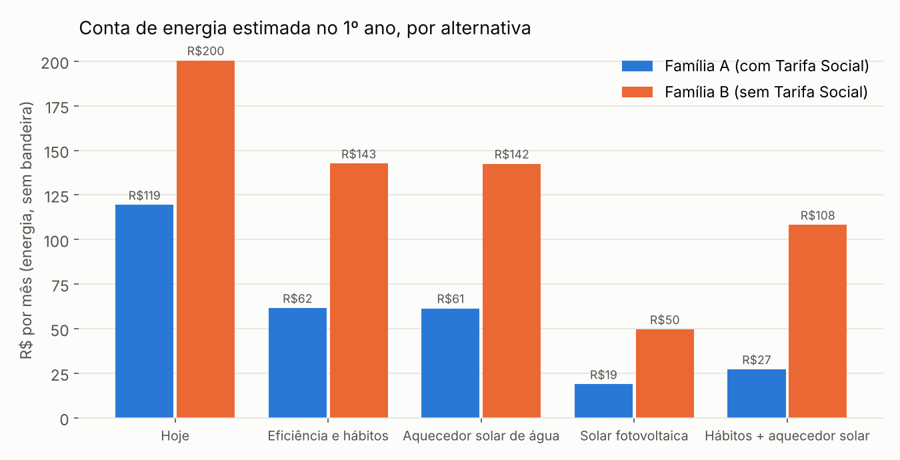

# Citizen Assist AI · Energia consciente para famílias de baixa renda

> **Global Solution 2026.2 — Ciência da Computação (1CC)**
> **Contribuição da disciplina: Soluções em Energias Renováveis e Sustentáveis (SERS)**
> Tudo o que está nas pastas `energia/`, `dados/`, `resultados/`, `docs/` e `tests/` é a contribuição de SERS.

## Integrantes

| Nome completo | RM |
|---|---|
| [Nome do integrante 1] | [RM] |
| [Nome do integrante 2] | [RM] |
| [Nome do integrante 3] | [RM] |

**Vídeo técnico (YouTube, não listado):** [colar link]

---

## 1. Público e problema

**Público:** famílias de baixa renda da Grande São Paulo (área da Enel SP), muitas delas inscritas no CadÚnico, que moram em casas com ligação **monofásica** e usam **chuveiro elétrico**.

**Necessidade energética:** a conta de luz pesa no orçamento e as famílias não sabem (1) quais aparelhos gastam mais, (2) como funciona a **Tarifa Social** (80 kWh grátis por mês desde a Lei 15.235/2025) e (3) se vale a pena investir em **aquecedor solar** ou **placas solares** — um mercado com muita promessa de "conta zero".

**Como o assistente ajuda:** o Citizen Assist AI conversa em linguagem simples, estima a conta da família, mostra onde está o desperdício e compara alternativas com números, fontes e limitações explícitas. Detalhes em [`docs/01_contexto.md`](docs/01_contexto.md).

## 2. Resultado principal da análise

Família de referência: 4 pessoas, **198 kWh/mês**, Enel SP, tarifa de **R$ 1,0135/kWh** com impostos (após o reajuste de 04/07/2026). Mesma necessidade, mesmo período (12 meses) e horizonte de 10 anos.

| Alternativa | Renovável | Investimento | Economia no 1º ano | Retorno | Saldo em 10 anos | CO₂ evitado/ano |
|---|:-:|--:|--:|--:|--:|--:|
| **A1** Eficiência + hábitos (LED, banho, posição verão, geladeira) | — | R$ 72 | R$ 694 | ~1 mês | R$ 6.870 | 41 kg |
| **A2** Aquecedor solar de água (200 L) | Sim | R$ 5.000 | R$ 696 | 8,7 anos | R$ 756 | 41 kg |
| **A3** Solar fotovoltaica on-grid — Família A (com Tarifa Social), 1,10 kWp | Sim | R$ 3.740 | R$ 1.207 | 3,2 anos | R$ 7.701 | 26 kg |
| **A3** Solar fotovoltaica on-grid — Família B (sem Tarifa Social), 1,65 kWp | Sim | R$ 5.610 | R$ 1.811 | 3,2 anos | R$ 11.551 | 40 kg |
| **A1+A2** Hábitos + aquecedor solar | Sim | R$ 5.072 | R$ 1.107 | 5,1 anos | R$ 4.799 | 65 kg |



**Recomendações que o assistente dá:**
1. **Sempre primeiro: hábitos + LED.** Custa R$ 72 e corta ~57 kWh/mês (≈ R$ 58/mês). Para quem tem Tarifa Social, cada kWh acima de 80 vale a tarifa cheia.
2. **Placas solares** têm o melhor saldo em 10 anos **se** a família tiver telhado próprio, conseguir investir sem se endividar e o projeto for homologado. A conta **não zera** (Fio B + valor mínimo).
3. **Aquecedor solar** se paga devagar com banhos curtos; compensa mais em famílias grandes/banhos longos (ex.: 5 banhos de 12 min → retorno ~4 anos) e tira carga do horário de pico.
4. Quem consome **até ~80 kWh** e tem Tarifa Social **não deve** investir em placas: a energia já é gratuita.

Análise completa: [`docs/02_analise_consumo.md`](docs/02_analise_consumo.md) · [`docs/03_comparacao_alternativas.md`](docs/03_comparacao_alternativas.md) · [`docs/04_recomendacoes_e_limitacoes.md`](docs/04_recomendacoes_e_limitacoes.md)

## 3. Funcionalidades de energia no assistente

| O usuário pergunta… | O assistente responde com… |
|---|---|
| "simular minha conta" | roteiro de 3 perguntas (kWh da conta, Tarifa Social, banhos) → conta estimada, peso do chuveiro e as 3 alternativas personalizadas |
| "gasto 250 kWh, somos 5 pessoas, banho de 12 minutos" | lê os números da frase e personaliza as respostas seguintes |
| "como economizar no chuveiro?" / "lâmpadas" / "geladeira" | kWh e R$ economizados por medida |
| "vale a pena placa solar?" | kWp, nº de placas, área, investimento, conta antes/depois, retorno, Fio B |
| "aquecedor solar compensa?" | economia, custo, retorno e condições de instalação |
| "compare as alternativas" | tabela das 4 opções + recomendação |
| "tarifa social" / "fio b" / "meio ambiente" | regras, impacto e emissões |
| "cuidados ao contratar" | checklist contra promessas enganosas |
| "quais as fontes?" / "quais as limitações?" | referências e premissas |

**Toda resposta numérica traz fontes e limitações** e é calculada na hora pelo mesmo código da análise (`energia/cenarios.py`) — o assistente nunca usa número "decorado". Optamos por regras (palavras-chave) em vez de IA generativa para garantir coerência com a análise e permitir auditoria.

## 4. Como executar

Requisitos: **Python 3.10+**. O assistente usa só a biblioteca padrão; `matplotlib` só é necessário para refazer os gráficos e `pytest` para os testes.

```bash
git clone <url-do-repositorio>
cd citizen-assist-ai
pip install -r requirements.txt     # opcional: matplotlib e pytest

python -m app.web                   # interface web → http://localhost:8000
python -m app.cli                   # conversa no terminal
python -m energia.relatorio         # recalcula tabelas (CSV) e gráficos (PNG)
python -m pytest -q                 # 25 testes automatizados
```

Para mudar uma premissa (tarifa, preço do Wp, fração solar…), edite `energia/parametros.py` e rode o relatório de novo: tabelas, gráficos e respostas do assistente se atualizam juntos.

## 5. Estrutura do repositório

```
citizen-assist-ai/
├── energia/                 ← contribuição SERS (código)
│   ├── parametros.py        todos os dados, com unidade, tipo (real/estimado) e fonte
│   ├── calculos.py          energia, conta, Tarifa Social, FV + Lei 14.300, payback, VPL, CO₂
│   ├── cenarios.py          perfis de família e alternativas A1, A2, A3, A1+A2 + sensibilidade
│   ├── assistente.py        módulo conversacional (intenções, simulação, fontes, limitações)
│   └── relatorio.py         gera resultados/*.csv e gráficos
├── app/
│   ├── web.py               interface web (http.server, sem dependências)
│   └── cli.py               interface de terminal
├── dados/aparelhos_familia_referencia.csv   inventário de consumo com origem de cada dado
├── resultados/              tabelas geradas + graficos/
├── docs/
│   ├── 01_contexto.md
│   ├── 02_analise_consumo.md
│   ├── 03_comparacao_alternativas.md
│   ├── 04_recomendacoes_e_limitacoes.md
│   ├── 05_referencias.md
│   ├── 06_testes_com_usuarios.md
│   ├── ficha_teste_usuario.md   ficha para imprimir nos testes
│   └── roteiro_video.md
├── tests/test_energia.py
├── entrega.txt              modelo do arquivo de entrega
└── requirements.txt
```

## 6. Referências, limitações e testes

- Referências verificáveis: [`docs/05_referencias.md`](docs/05_referencias.md)
- Limitações das estimativas: [`docs/04_recomendacoes_e_limitacoes.md`](docs/04_recomendacoes_e_limitacoes.md)
- Testes com usuários (protocolo, registros e ajustes): [`docs/06_testes_com_usuarios.md`](docs/06_testes_com_usuarios.md)

> **Atenção:** os valores são **estimativas** para orientação. Não substituem orçamento técnico, projeto elétrico ou informação da distribuidora.
