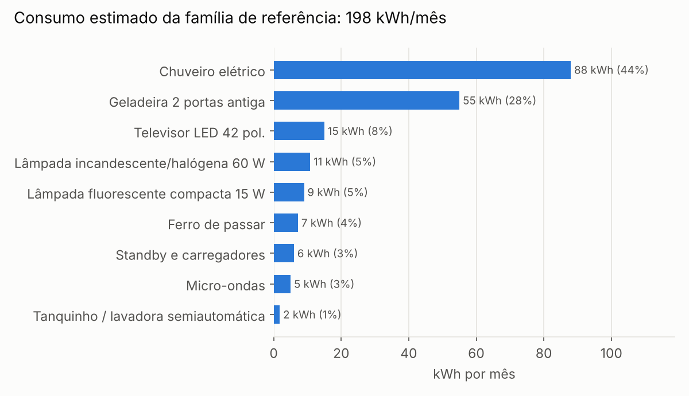

# 2. Análise de consumo

**Período de referência:** 1 mês típico, anualizado (×12). **Unidades:** potência em W/kW, energia em kWh, custo em R$.
**Tipos de dado:** cada número está marcado como **real/público** (publicado por órgão, empresa ou estudo) ou **estimado** (premissa da equipe, justificada). Lista completa e gerada pelo código: [`resultados/parametros_utilizados.csv`](../resultados/parametros_utilizados.csv).

## 2.1 Conceito usado

**Energia = Potência × Tempo** → E (kWh) = P (kW) × t (h)
**Custo = Energia faturada × Tarifa**

Exemplo (chuveiro): 5.500 W = 5,5 kW; 4 banhos × 8 min = 32 min/dia = 0,533 h/dia
E = 5,5 kW × 0,533 h/dia × 30 dias = **88 kWh/mês** (mesmo valor de referência do Procel/Eletrobras para 30 min/dia [R17]).

## 2.2 Tarifa (Enel SP, B1 residencial)

| Passo | Valor | Tipo | Fonte |
|---|---|---|---|
| TE + TUSD sem tributos (jul/2025–jul/2026) | 0,29274 + 0,43244 = **0,72518 R$/kWh** | real/público | R1 |
| Reajuste residencial a partir de 04/07/2026 | **+9,02%** | real/público | R2 |
| Tarifa sem tributos 2026 | 0,72518 × 1,0902 = **0,7906 R$/kWh** | estimado (cálculo) | R1, R2 |
| Fator de tributos (ICMS 18% + PIS/COFINS), da fatura | 0,92964 ÷ 0,72518 = **1,2819** | real/público | R1 |
| **Tarifa com tributos usada** | 0,7906 × 1,2819 = **1,0135 R$/kWh** | estimado (cálculo) | R1, R2 |

Não incluídos: bandeiras tarifárias (premissa: verde) e contribuição de iluminação pública (não muda com as alternativas).

## 2.3 Inventário da família de referência (4 pessoas)

Arquivo: [`dados/aparelhos_familia_referencia.csv`](../dados/aparelhos_familia_referencia.csv)

| Aparelho | Premissa de uso | kWh/mês | % | Tipo |
|---|---|--:|--:|---|
| Chuveiro elétrico 5.500 W | 4 banhos × 8 min/dia | 88,0 | 44% | estimado (Procel) |
| Geladeira 2 portas antiga | 48 kWh (Eletrobras) + 15% por idade/vedação | 55,0 | 28% | estimado |
| TV LED 42" 100 W | 5 h/dia | 15,0 | 8% | estimado |
| 2 lâmpadas incandescentes/halógenas 60 W | 3 h/dia | 10,8 | 5% | estimado |
| 4 lâmpadas fluorescentes 15 W | 5 h/dia | 9,0 | 5% | estimado |
| Ferro de passar | 12 h/mês (Eletrobras) | 7,2 | 4% | real/público |
| Standby e carregadores | — | 6,0 | 3% | estimado |
| Micro-ondas 1.000 W | 10 min/dia | 5,0 | 3% | estimado |
| Tanquinho | 0,15 kWh × 12 ciclos | 1,8 | 1% | real/público |
| **Total** | | **197,8** | 100% | |

**Validação do total:** o consumo médio residencial brasileiro chegou a ~182 kWh/mês em 2026 (EPE) e a EPE projeta média próxima disso até 2035 [R19]. Uma família de 4 pessoas com chuveiro elétrico em SP em torno de 200 kWh é coerente. O peso do chuveiro (44%) fica acima da média nacional (~24% [R18]) porque a média nacional inclui regiões quentes, onde quase não se usa chuveiro elétrico.

## 2.4 Conta mensal hoje

| | Família A (com Tarifa Social) | Família B (sem Tarifa Social) |
|---|---|---|
| Regra | 80 kWh gratuitos; o resto pela tarifa cheia [R3] | tudo cobrado; mínimo de 30 kWh (monofásico) [R4] |
| kWh faturados | 197,8 − 80 = 117,8 | 197,8 |
| **Energia na conta** | 117,8 × 1,0135 = **R$ 119,38** | 197,8 × 1,0135 = **R$ 200,46** |

**Achado importante para o público:** com a Tarifa Social, cada kWh economizado **acima de 80 kWh** vale a tarifa inteira (R$ 1,01). Abaixo de 80 kWh, economizar mais não muda a conta — e investir em placa solar não faz sentido.

## 2.5 Onde está o potencial de economia
1. **Chuveiro** (44%): tempo de banho e posição verão; ou aquecimento solar.
2. **Geladeira** (28%): vedação e ventilação agora; troca por modelo eficiente no futuro.
3. **Iluminação** (10%): troca por LED, investimento baixíssimo.
4. **Standby** (3%): hábito de desligar da tomada.
