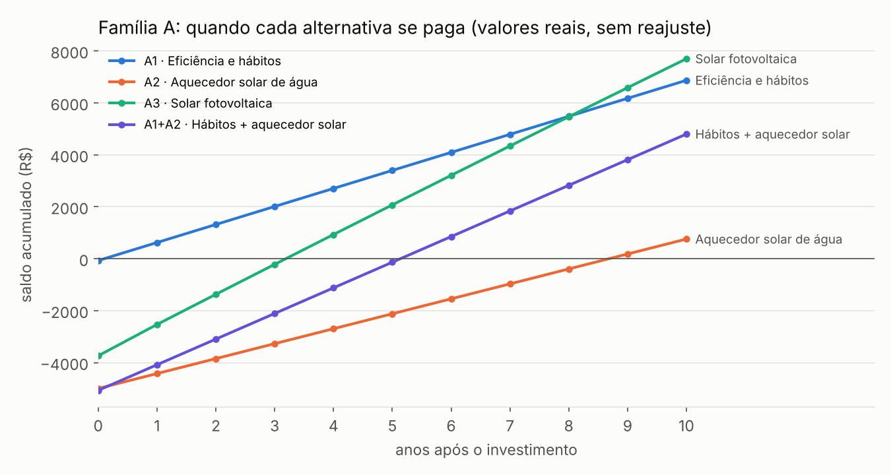

# 3. Comparação das alternativas

**Mesma necessidade:** energia elétrica da família de referência (197,8 kWh/mês, Enel SP).
**Mesmo período de referência:** 12 meses para energia e custos; **10 anos** para viabilidade financeira (valores reais, sem inflação da tarifa no cenário base; taxa de desconto real de 6% a.a. para o VPL).
Código: [`energia/cenarios.py`](../energia/cenarios.py) · Tabelas: [`resultados/`](../resultados/)

## 3.1 A1 — Eficiência energética e hábitos (não renovável, custo baixo)

| Medida | Cálculo | Economia (kWh/mês) |
|---|---|--:|
| Banho de 8 → 6 min + posição verão (3.200 W) por 6 meses | antes 88,0; depois (66,0 × 6 + 38,4 × 6) ÷ 12 = 52,2 | 35,8 |
| 2 incandescentes 60 W → LED 9 W | 2 × 0,051 kW × 3 h × 30 | 9,2 |
| 4 fluorescentes 15 W → LED 9 W | 4 × 0,006 kW × 5 h × 30 | 3,6 |
| Geladeira: vedação, 15 cm da parede, porta fechada | 10% × 55 | 5,5 |
| Standby | estimado | 3,0 |
| **Total** | | **57,1** |

Investimento: 6 LEDs × R$ 12 = **R$ 72**. Economia: 57,1 × 1,0135 ≈ **R$ 57,85/mês = R$ 694/ano**. Retorno ≈ **1 mês**.

## 3.2 A2 — Aquecedor solar de água (🌱 renovável térmica)

- Sistema de 200 L com ~3 m² de coletores, adequado para 3–4 pessoas [R12, R13].
- **Fração solar 65%** (estimada): o sol fornece 65% da energia de aquecimento no ano; o chuveiro continua como apoio em dias nublados.
- Energia evitada: 88,0 × 0,65 = **57,2 kWh/mês** → **R$ 695,64/ano**; menos R$ 120/ano de manutenção.
- Investimento: **R$ 5.000** (estudo de caso: R$ 4.180 [R12]; mercado pode passar de R$ 7.000 [R13]).
- Retorno simples: 5.000 ÷ (695,64 − 120) ≈ **8,7 anos**.

## 3.3 A3 — Solar fotovoltaica conectada à rede (🌱 renovável elétrica)

**Geração por kWp em SP:** 4,632 kWh/m².dia (plano inclinado, RMSP [R7]) × PR 0,75 × 365 ÷ 12 = **105,7 kWh/mês por kWp**.

**Dimensionamento:** cobre o consumo que de fato é cobrado.
- Família B: 197,8 − 30 (mínimo) = 167,8 kWh → 1,59 kWp → **3 módulos de 550 W = 1,65 kWp** (≈ 174 kWh/mês, ~8 m²).
- Família A: 197,8 − 80 (gratuitos) = 117,8 kWh → 1,11 kWp → **2 módulos = 1,10 kWp** (≈ 116 kWh/mês, ~5 m²).

**Fatura com geração (Lei 14.300) — modelo mensal:**
1. 30% da geração é consumida na hora (simultaneidade; família fora de casa de dia).
2. O resto é injetado e compensa o consumo da rede.
3. Sobre cada kWh compensado paga-se a parte não compensada do **Fio B**: 0,22 R$/kWh (estimado) × 1,2819 (tributos) × 75% em 2027 / 90% de 2028 em diante.
4. Paga-se o maior entre (consumo líquido + Fio B) e o custo de disponibilidade (30 kWh), conforme esclarecimento da ANEEL [R4].

Exemplo Família B, 1º ano (2027): geração 174,4 kWh; autoconsumo 52,3; injetado e compensado 122,0; Fio B = 122,0 × 0,22 × 1,2819 × 0,75 = R$ 25,81; mínimo = 30 × 1,0135 = R$ 30,41; consumo líquido = 197,8 − 52,3 − 122,0 ≈ 23,4 kWh ≈ R$ 23,76 → 23,76 + 25,81 = **R$ 49,57/mês** (antes: R$ 200,46).

| | Família A | Família B |
|---|--:|--:|
| Potência | 1,10 kWp | 1,65 kWp |
| Investimento (3,40 R$/Wp) | R$ 3.740 | R$ 5.610 |
| Conta 2027 → 2028 | R$ 18,79 → R$ 22,71 | R$ 49,57 → R$ 55,46 |
| Economia no 1º ano | R$ 1.207 | R$ 1.811 |
| Retorno simples | 3,2 anos | 3,2 anos |

O aumento da conta de 2027 para 2028 é o efeito do Fio B passando de 75% para 90%. Ano a ano: `resultados/fotovoltaica_ano_a_ano_familia_*.csv`.

## 3.4 Quadro comparativo (Família A — público principal)

| Critério | A1 Hábitos + LED | A2 Aquecedor solar | A3 Fotovoltaica | A1+A2 |
|---|---|---|---|---|
| Investimento | R$ 72 | R$ 5.000 | R$ 3.740 | R$ 5.072 |
| kWh da rede evitados/mês | 57 | 57 | 116 | 91 |
| Conta de energia/mês | R$ 119 → **R$ 62** | → R$ 61 | → **R$ 19** | → R$ 27 |
| Retorno simples | **~1 mês** | 8,7 anos | 3,2 anos | 5,1 anos |
| VPL 10 anos (6% a.a.) | R$ 5.037 | **−R$ 763** | R$ 4.709 | R$ 2.193 |
| CO₂ evitado/ano | 41 kg | 41 kg | 26 kg (líquido de fabricação) | 65 kg |
| Viabilidade prática | imediata, qualquer moradia | precisa de telhado, caixa d'água, ~R$ 5 mil | telhado próprio, homologação Enel, ~R$ 4 mil | soma das duas |
| Riscos | depende de adesão aos hábitos | economia menor com banhos curtos | Fio B crescente; regra pós-2028 indefinida; interação com Tarifa Social | — |

## 3.5 Impactos ambientais

- **Eletricidade brasileira já é limpa:** 59,9 kgCO₂eq/MWh no setor elétrico em 2024 [R14] (em meses chuvosos de 2025 o fator do SIN ficou entre 21 e 29 kg/MWh [R15]). Por isso o CO₂ evitado é pequeno em todas as opções (dezenas de kg/ano).
- **Fotovoltaica:** emite ~41 gCO₂eq/kWh no ciclo de vida (fabricação) [R16]; o ganho líquido é (59,9 − 41) g por kWh. Gera resíduo eletrônico ao fim da vida útil (25+ anos) que exige reciclagem.
- **Aquecedor solar:** reduz o consumo justamente no **horário de pico** (18h–21h), quando o chuveiro concentra a carga residencial e o sistema aciona térmicas a gás/carvão; usa cobre, vidro e alumínio recicláveis.
- **Eficiência:** menor impacto de todos — energia que não é usada não é gerada nem transmitida. LEDs duram mais e não têm mercúrio (as fluorescentes retiradas devem ir para coleta). Geladeiras antigas precisam de descarte adequado do gás refrigerante.

## 3.6 Sensibilidade (premissas incertas)

| Cenário | Efeito |
|---|---|
| Adesão de só 50% aos hábitos (A1) | economia cai para R$ 347/ano; retorno ainda ~3 meses |
| Aquecedor a R$ 4.180 / R$ 7.000 | retorno 7,3 anos / não se paga em 10 anos |
| FV a 2,45 / 4,20 R$/Wp | retorno 2,3 / 4,0 anos |
| Tarifa subindo 3% ao ano acima da inflação | A2: 7,7 anos; A3: 3,1 anos |
| Família maior: 5 banhos de 12 min, 260 kWh, sem TS | A2 passa a se pagar em ~4,2 anos |

Tabela completa: [`resultados/sensibilidade.csv`](../resultados/sensibilidade.csv).

## 3.7 Conclusão técnica
- **A1 domina** em custo-benefício e deve ser sempre a primeira recomendação.
- Entre as **renováveis**, a **fotovoltaica** tem melhor retorno para o perfil de referência; o **aquecedor solar** depende muito do uso de água quente e é mais vantajoso em famílias grandes, mas é a opção que alivia o pico da rede.
- A barreira real para o público de baixa renda é o **investimento inicial**, não o retorno — por isso o assistente sempre mostra o caminho de custo quase zero primeiro e alerta sobre financiamento e promessas de "conta zero".
